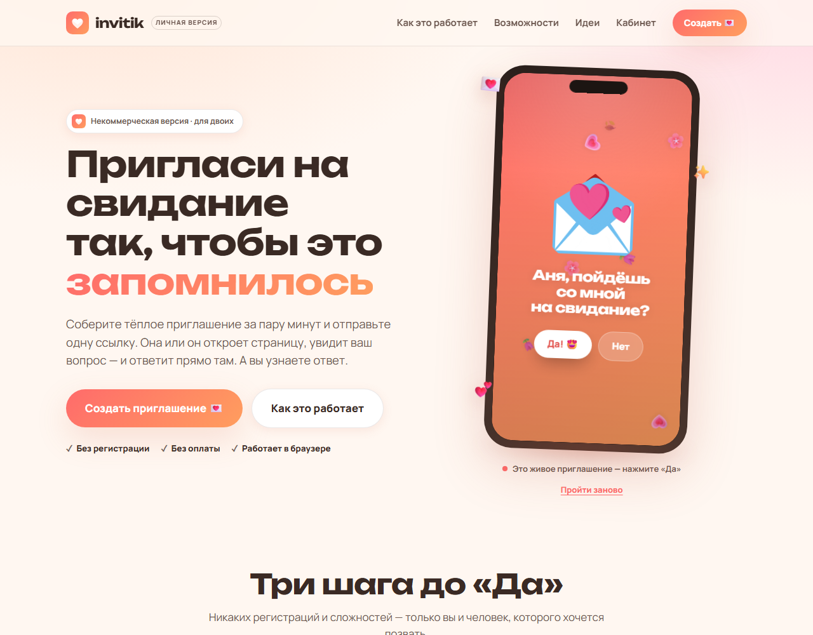
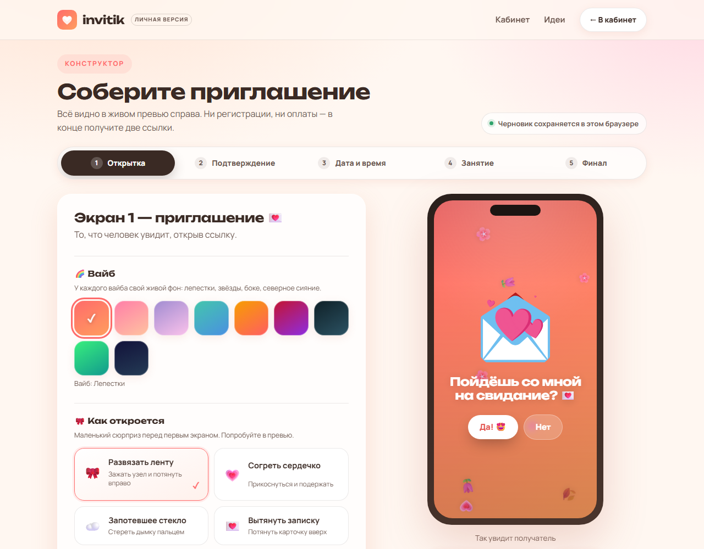
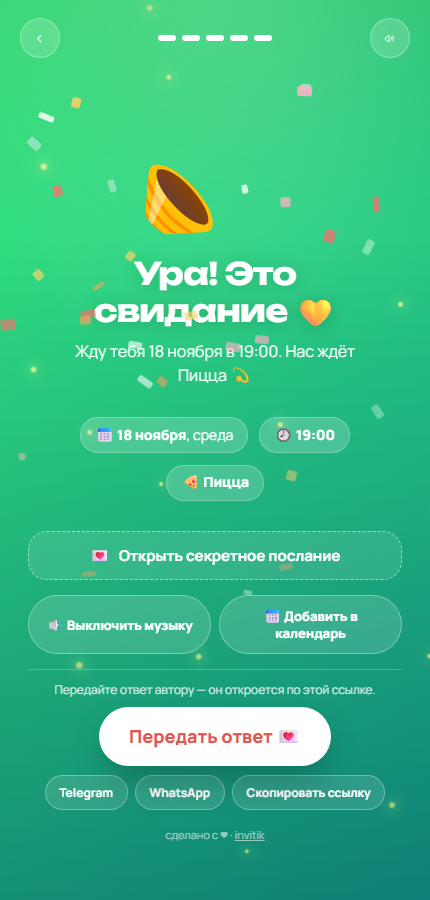
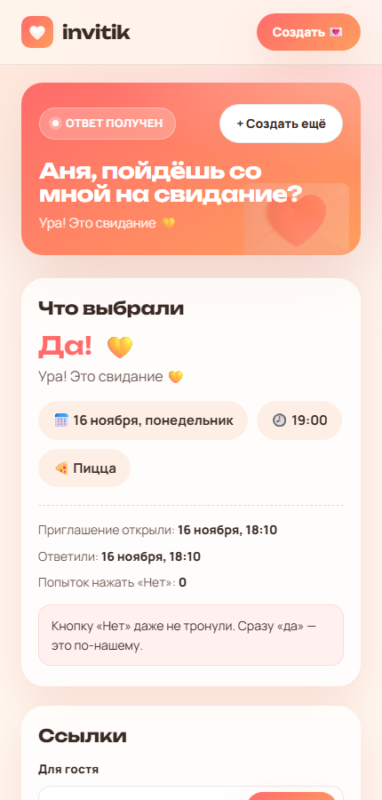

# invitik — личная версия

Некоммерческая статическая реализация конструктора приглашений на свидание
по мотивам [invitik.ru](https://invitik.ru). Без регистрации, оплаты, серверов
и сборщиков: открыл `index.html` — и всё работает.

## Что внутри

- **Лендинг** с живым демо в телефоне: кнопка «Нет» убегает прямо на главной.
- **Конструктор из 5 шагов** с настоящим живым превью (тот же движок, что у гостя).
- **Приглашение** (`i.html`): вступление-жест, вопрос, «Да» с сердцами,
  четыре характера кнопки «Нет», календарь, выбор занятия, финал с музыкой,
  конфетти, альбомом, секретным посланием и `.ics`.
- **Кабинет** (`cabinet.html`): ответ гостя, выбранный план, число попыток
  нажать «Нет», ссылки и история приглашений в этом браузере.
- **Идеи** (`ideas.html`): сценарии и 8 готовых текстов с копированием.
- **Приватность** (`privacy.html`): честное описание того, где лежат данные.

## Как выглядит

| Главная | Конструктор |
|---|---|
|  |  |

| Приглашение | Кабинет |
|---|---|
|  |  |

## Запуск

```bash
node serve.js          # http://localhost:8080
```

Любой статический сервер подойдёт, сборка не нужна. Можно даже открыть
`index.html` файлом, но тогда браузер может ограничить `localStorage`
и шрифты — лучше через `serve.js`.

## Как это устроено

Приглашение целиком упаковывается в ссылку:

```
i.html#d=<сжатый JSON>          — ссылка для гостя
cabinet.html#d=<тот же JSON>    — ваш кабинет
```

`#`-часть не отправляется на сервер хостинга. Внутри — текст вопроса, вайб,
варианты даты, занятия и всё остальное. Сжатие — `deflate-raw` через
`CompressionStream`, с откатом на обычный base64.

Ответ возвращается так же: гость нажимает «Передать ответ», и вы получаете
ссылку `cabinet.html#d=…&a=<ответ>`. Открыли — увидели дату, время, занятие
и попытки нажать «Нет». Список приглашений хранится в `localStorage`.

### Почему не «сразу в кабинете»

На чистом статическом хостинге нет сервера, который принял бы ответ.
Поэтому по умолчанию используется возврат ссылкой — это работает всегда
и ничего не требует. Если хочется мгновенной доставки, подключите релей.

## Релей (необязательно)

Бесплатный Cloudflare Worker + KV, ~60 строк: `worker/relay.js`.

1. Создайте KV namespace `INVITIK` и привяжите его к воркеру.
2. Задеплойте `worker/relay.js` (Dashboard → Workers → Create, или `wrangler deploy`).
3. Пропишите адрес в `js/config.js`:

```js
window.INVITIK_CONFIG = { relayUrl: 'https://invitik-relay.you.workers.dev' };
```

После этого гость при ответе сам отправит данные на релей, а кабинет будет
опрашивать его раз в несколько секунд. Без релея всё продолжает работать.

## Деплой

Скопируйте папку на любой статический хостинг:

- **GitHub Pages** — положите содержимое в репозиторий и включите Pages.
- **Netlify / Cloudflare Pages / Vercel** — drag & drop папки, build command пустой.
- **Свой сервер** — просто отдавайте файлы.

Ссылки относительные, поэтому сайт работает и в подпапке (`/invitik/`).

## Настройка

- `js/config.js` — название, адрес релея.
- `css/app.css` — палитра, шрифты, радиусы.
- `js/vibes.js` — список вайбов (градиент + тип частиц) и встроенная мелодия.
- `js/stickers.js` — каталог стикеров и готовых занятий.
- `js/demo.js` — демо-приглашение на главной и `i.html?demo=1`.

## Ограничения

- Ссылка содержит все данные: большое загруженное фото удлиняет её.
  Для длинных ссылок есть предупреждение и совет заменить фото на стикер.
- Список приглашений привязан к браузеру (это `localStorage`).
- Правка приглашения создаёт новую ссылку — старую нужно заменить.
- Ответ без релея требует одного нажатия «Передать ответ» у гостя.

## Лицензия и благодарности

Проект личный и некоммерческий, не связан с оригинальным сервисом.
Анимированные эмодзи — [Noto Emoji](https://googlefonts.github.io/noto-emoji-animation/)
от Google, CC BY 4.0. Шрифты Unbounded и Manrope — Google Fonts (OFL).
